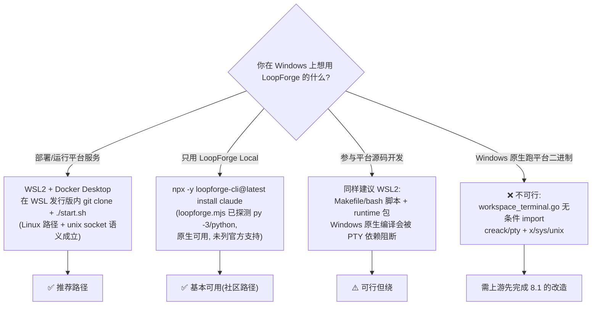

# LoopForge - Windows 兼容性分析

> 生成时间: 2026-11-15
> 数据来源：全仓脚本扫描（`out/05-Windows兼容性检查.md`）+ 源码人工核查。结论按「平台服务（Go+Docker）」「前端/测试（Node）」「LoopForge Local（npm+Python）」三部分分别评估。

## 总体评估

| 指标 | 结果 |
|------|------|
| 总体评级 | ⚠️ 部分兼容（分组件：平台服务 ❌ 不兼容 Windows 原生；Local 的 npx 入口 ✅ 基本可用；整体部署可经 WSL2 实现） |
| 高危问题 | 2 |
| 中危问题 | 4 |
| 低危问题 | 2 |
| 已正确适配项 | 5 |

### 评级说明

| 等级 | 含义 |
|------|------|
| ✅ 完全兼容 | 项目可在 Windows 上正常构建和运行 |
| ⚠️ 部分兼容 | 可构建但部分功能不可用，需少量修复 |
| ❌ 不兼容 | 无法在 Windows 上构建或核心功能不可用 |

**一句话结论**：LoopForge 平台服务是面向 Linux/macOS + Docker 的系统，Windows 上没有原生构建/运行路径，官方文档与安装器均不含 Windows；在 Windows 机器上的正确用法是 **WSL2 + Docker Desktop，在 WSL 发行版内照常 `./start.sh`**。仓库中唯一对 Windows 原生友好的入口是 LoopForge Local 的 npm 包。

## 1. 构建系统兼容性

### 1.1 构建入口（无 package.json scripts 问题——Go + Make + bash）

| 入口 | 命令 | 问题 | 严重程度 |
|------|------|------|----------|
| `Makefile` | 全部 recipe 为 bash 语法 | Windows 无默认 make/bash；`GOCACHE=/tmp/agentflow-gocache`（Makefile:3）是 Unix 路径 | MEDIUM |
| `scripts/build-binaries.sh` | 交叉编译 4 个二进制 | 目标平台仅 linux/darwin amd64/arm64（如 `build-gate-mcp`，Makefile:69-72），**不产 windows 目标** | HIGH（表明无 Windows 支持意图） |
| `Dockerfile` | 3 阶段（node chatbot → golang build → node:22-bookworm 运行） | Linux 容器构建，与 Windows 原生无关（容器内构建本身可在 Docker Desktop 完成） | INFO |

### 1.2 生命周期 Hooks

无 npm lifecycle hooks 依赖（Go 项目）；前端构建封装在 Dockerfile/Vite 内，无平台特定 hook。INFO。

### 1.3 构建工具链

| 工具 | Windows 支持 | 说明 |
|------|-------------|------|
| Go 1.26.11 工具链 | ⚠️ 理论可用 | 但被源码级 Unix 依赖阻断（见 2.3），`go build ./cmd/agentflow` 在 Windows 直接编译失败 |
| bash（scripts/ 全部 20+ 脚本） | ✗ 需 Git Bash/WSL | 无任何 `.ps1`/`.cmd`/`.bat` 对应物（全仓扫描为空，`05-Windows兼容性检查.md`） |
| Docker/Compose | ⚠️ | Docker Desktop 可用，但安装器强制探测**本地 unix socket**（`/var/run/docker.sock` 或 `unix://`，`scripts/install.sh:127-139`），Windows 原生路径不满足 |

## 2. 源代码兼容性

### 2.1 子进程调用

| 文件 | 位置 | 调用方式 | 问题 |
|------|------|----------|------|
| `internal/runtime/workspace_terminal.go` | ~60 | `exec.Command("/bin/sh","-c",…)` | Unix shell 路径硬编码 |
| 各沙箱/节点执行 | `internal/engine/node_execute.go:616-628` 等 | 沙箱内 `sh -lc` | 在容器内执行，不涉及 Windows 宿主（INFO） |

### 2.2 平台相关代码

| 文件 | 位置 | 问题类型 | 说明 |
|------|------|----------|------|
| `internal/runtime/workspace_terminal.go` | 16-17 | **编译阻断** | 无 build tag 直接 `import "github.com/creack/pty"` 与 `"golang.org/x/sys/unix"`（后者在 Windows 无实现）；该包被 `cmd/agentflow`/`cmd/agentflow-runner` 全链路依赖 → **平台二进制无法在 Windows 原生编译**（已人工核验） |
| `internal/domain/assets.go` | 173-186 | 驱动映射缺失 | `ResolveSandboxDriver` 仅映射 darwin→seatbelt、linux→bwrap，其他 OS 直接报错「系统轻量隔离（native）仅支持 macOS 与 Linux」 |
| `internal/runtime/git_isolation.go` | 228-235 | /proc 依赖 | Linux 走 `/proc` 锁检测，非 Linux 回退 `lsof`（Windows 两者皆无） |
| `internal/runtime/workspace_terminal_sandbox.go` | 300-327 | /proc 依赖 | 读 `/proc/<pid>/environ` |
| `internal/scriptview/scriptview_linux.go` | 25-44 等 | Linux-only | 读 `/proc/1/status`、`/proc/1/ns/*`、mountinfo；非 Linux 由 `scriptview_other.go:8` 明确报错 |

### 2.3 Unix 专用 API

| API | 文件 | 行号 | Windows 替代方案 |
|-----|------|------|-----------------|
| PTY（`pty.Start` 等） | `internal/runtime/workspace_terminal.go` | 16-17, 251 | 需 `conhost`/`winpty` 或 build tag 拆分 + Windows 存根（上游未做） |
| `unix.IoctlGetInt(TIOCGPGRP)` | 同上 | 251 | 无直接等价 |
| `syscall.SIGHUP`（handover） | `cmd/agentflow/main.go` | 259-268 | Windows 无 SIGHUP；进程交接需另设计 |
| 进程组 `Setpgid`+`Kill(-pid)` | `internal/procwatch/group_unix.go`、`internal/runner/exec.go:495-501` | — | 见 7「已正确适配」：procwatch 有 windows 存根，runner 有 windows 分支 |

`go:build` 全量扫描结论：平台 tag 仅 `procwatch`、`managedcli`、`scriptview` 三组（`linux`/`darwin` + `!linux && !darwin` 存根）；`internal/runtime` 的 PTY 代码**没有**对应存根——这就是原生编译断在 runtime 包的原因。

## 3. 文件系统兼容性

### 3.1 路径处理

| 问题 | 文件 | 行号 | 说明 |
|------|------|------|------|
| Docker socket 绝对路径 | `compose.yaml` | 57 | 挂载 `/var/run/docker.sock`，要求 Linux 语义 daemon |
| bind mount 同绝对路径 | `compose.yaml` | 56 | `LOOPFORGE_DATA_DIR` 必须以**相同绝对路径**挂进容器（宿主 daemon 解析 bind mount）；Windows 路径（`D:\...`）不满足 |
| 会话/工作区目录 | `compose.yaml` | 36-38 | `AGENTFLOW_CONVERSATION_DIR` 等指向 Linux 容器内路径 |

推论：从 Windows 侧（PowerShell + Windows 路径 checkout）跑 `start.sh` 不可行；在 **WSL2 发行版内**（Linux 路径 + Docker Desktop WSL 集成）则语义完全成立。

### 3.2 符号链接

未发现运行时依赖 symlink 的核心逻辑（检查点用 staging+rename）；Docker/CLI 层无 Windows symlink 特殊处理需求。INFO。

## 4. Shell 和脚本兼容性

### 4.1 Shell 脚本（20+ 个，节选）

| .sh 文件 | 对应 .ps1 | 对应 .cmd | 说明 |
|----------|-----------|-----------|------|
| `start.sh`、`scripts/install.sh`、`scripts/dev.sh`、`scripts/configure.sh` 等 | ✗ | ✗ | 安装/运维主路径，bash-only |
| `e2e/run.sh`、`e2e/local.sh`、`e2e/coverage/report.sh` | ✗ | ✗ | 测试入口，bash-only |
| `local/install.sh`（`/bin/sh`） | ✗ | ✗ | `curl \| sh` 安装 Local；Windows 用 `npx` 替代 |
| `internal/runtime/browser_assets/entrypoint.sh` | — | — | 容器内执行，与宿主无关 |

全部无 `.ps1`/`.cmd` 对应物（`05-Windows兼容性检查.md` 第 5 节：未发现）。

### 4.2 环境变量

变量本身（`AGENTFLOW_*`/`LOOPFORGE_*`）跨平台无语义问题；`.env` 加载逻辑（`cmd/agentflow/main.go:36-75`）用 `filepath` 与 `TrimPrefix("export ")`，在 Windows 上也能解析。唯一注意：`MIRROR`、`LOOPFORGE_YES=1` 等「命令前缀环境变量」写法依赖 POSIX shell 语法。

## 5. 测试和 CI/CD 兼容性

### 5.1 CI 配置

| 工作流 | Runner | Windows 支持 | 说明 |
|--------|--------|-------------|------|
| `e2e.yml` | ubuntu-latest（py3.8/3.12 × node20/22）+ macos-latest | ✗ 未覆盖 | matrix 无 windows-latest |
| `platform.yml` / `release.yml` / `release-local.yml` / `validate.yml` | ubuntu-latest | ✗ 未覆盖 | 全部 Linux-only |

### 5.2 测试覆盖

| 测试类型 | Windows 是否覆盖 | 说明 |
|----------|-----------------|------|
| Go 单测（`make test`） | ✗ 未验证可跑 | runtime 包编译阻断会连带大部分包；`internal/repo` 等纯逻辑包理论上可跑 |
| webtest（node --test + jsdom + c8） | ⚠️ 理论可跑 | 纯 Node，无平台依赖证据，但入口经 Makefile/bash |
| e2e（node --test + Playwright） | ✗ | `e2e/run.sh` bash-only，且依赖 Linux 容器栈 |

## 6. 依赖兼容性

### 6.1 原生模块（Go）

| 依赖 | 是否需要编译 | Windows 支持 |
|------|-------------|-------------|
| `github.com/creack/pty` | 纯 Go 但含 Unix syscall | ✗ 不支持 Windows（且有 `x/sys/unix` 显式 import） |
| `golang.org/x/sys/unix` | 纯 Go | ✗ 无 Windows 实现（应改用 `golang.org/x/sys/windows` 并 build tag 拆分） |
| `gorm.io/driver/mysql`、`glebarez/sqlite`（纯 Go） | 否 | ✅ |
| `gorilla/websocket`、`gin` 等 | 否 | ✅ |

### 6.2 可疑依赖

| 依赖 | 问题 | 替代方案 |
|------|------|----------|
| `klauspost/compress`、`goccy/go-yaml` 等 | 无 Windows 问题 | — |
| 运行时 `docker` CLI（镜像内置 docker:27-cli） | 假定 Unix daemon | Docker Desktop（WSL2 后端） |

## 7. 已正确处理的适配

| 适配项 | 文件 | 行号 | 处理方式 |
|--------|------|------|----------|
| 进程组终止的 Windows 存根 | `internal/procwatch/group_windows.go` | 7-8 | build tag 拆分，Windows 下退化为杀直接子进程 |
| runner 执行的 Windows 分支 | `internal/runner/exec.go` | 469, 490 | `setProcessGroup`/`terminateProcessGroup` 在 windows 下 `Process.Kill()`（因上游 runtime 包阻断，当前为死代码，但意图正确） |
| managedcli 平台存根 | `internal/managedcli/coordinator_unsupported.go`、`command_other.go` | — | `!linux && !darwin` 明确降级 |
| scriptview 非 Linux 明确报错 | `internal/scriptview/scriptview_other.go` | 8 | 返回「require Linux inside the Docker helper」而非崩溃 |
| **Local 的 Windows 启动器** | `local/bin/loopforge.mjs` | 10-52 | `process.platform === "win32"` 时依次探测 `py -3`/`python`/`python3`，`spawnSync` 带 `windowsHide`，PYTHONPATH 用 `path.delimiter` 拼接 |

## 8. 修复建议

### 8.1 必须修复 (HIGH) —— 仅当目标是「原生支持 Windows」

> 该项目当前定位即 Linux/macOS 服务，以下不是缺陷，而是若上游想支持 Windows 原生需做的事：

1. **PTY 编译阻断**：给 `internal/runtime/workspace_terminal.go` 加 `//go:build !windows` 并提供 Windows 存根（终端池降级为无 PTY 的 pipe 模式或直接禁用工作区终端）；同时把 `unix.IoctlGetInt(TIOCGPGRP)` 等挪进 unix 文件。
2. **沙箱驱动缺失**：`ResolveSandboxDriver`（`internal/domain/assets.go:173-186`）为 Windows 增加 `docker`-only 映射（Windows 原生 + Docker Desktop 的 named pipe daemon），并让安装器接受 `npipe://` socket。
3. **发布产物**：`scripts/build-binaries.sh`/Makefile 增加 windows/amd64 目标。

### 8.2 建议修复 (MEDIUM)

4. **运维脚本无 Windows 对等物**：为 `start.sh`/`install.sh` 提供 `start.ps1` 或文档明确「Windows 请在 WSL2 内执行」；`Makefile` 的 `GOCACHE=/tmp/...` 改为环境变量默认值。
5. **CI 增加 Windows matrix**：至少给 `local/`（npm + Python）与 `webtest` 加 `windows-latest`，防止唯一跨平台组件退化。
6. **部署文档**：`docs/deployment.md` 增补 WSL2 + Docker Desktop 的认证步骤（checkout 放 WSL 文件系统内、数据目录用 WSL 绝对路径），当前文档完全没有 Windows 字样。

### 8.3 可选改进 (LOW)

7. `local/install.sh`（curl|sh）在 Windows 无效：在 README 的 Local 段落置顶 `npx` 用法（当前已并列，可强化提示）。
8. Go 纯逻辑包（`internal/repo`、`internal/cronexpr` 等）可在 Windows 上跑单测验证，作为渐进兼容的第一步。

## 9. 兼容性流程图

### Windows 用户速查

| 目标 | 可行性 | 做法 |
|------|--------|------|
| 部署整个平台 | ✅（经 WSL2） | WSL2 内装 Docker Desktop 集成，clone 到 WSL 文件系统，`./start.sh` |
| Local 工作流 | ✅ | `npx -y loopforge-cli@latest install claude`（宿主需 Node 20+/Python 3.8+） |
| 平台源码 `go build` | ❌ | runtime 包 Unix 依赖阻断；请用 WSL2 或 Linux 容器 |
| CI/官方支持 | ❌ | 5 个 GitHub Actions workflow 均无 Windows runner |
