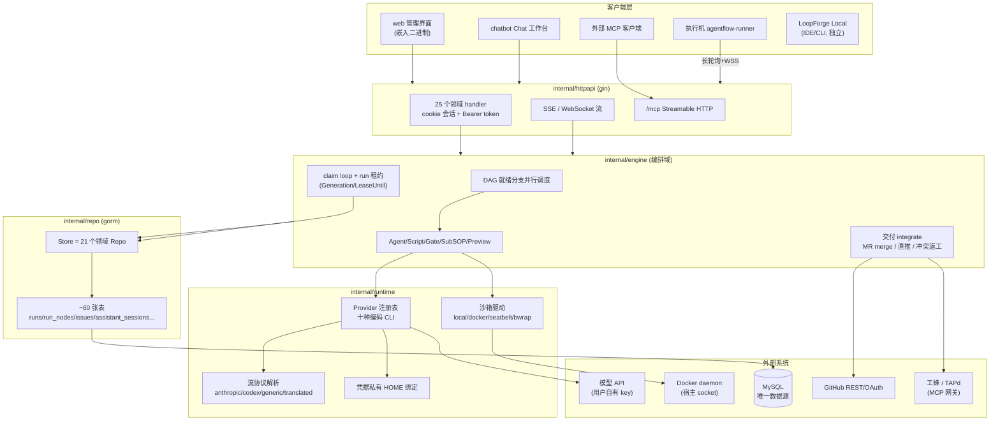
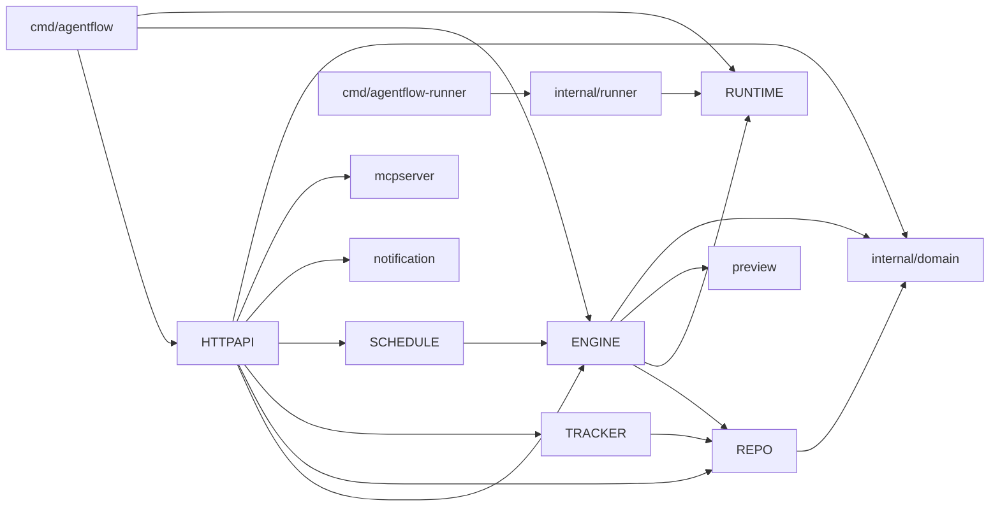

# LoopForge - 架构分析

> 生成时间: 2026-11-15
> 分析对象: Tencent/LoopForge（Go module 名沿用上游 `agentflow`），版本 0.3.8+（`compose.yaml` 镜像 pin `ghcr.io/tencent/loopforge:0.3.8`）

## 1. 项目概览

### 1.1 项目信息

| 项目 | 内容 |
|------|------|
| 名称 | LoopForge |
| 语言 | Go 1.26.11（主体）+ TypeScript/JavaScript（前端）+ Python（local/ 工作流与脚本） |
| 类型 | 自托管 AI 编码代理编排平台（chat 工作台 + SOP 工作流引擎） |
| 描述 | 团队在自有基础设施上用编码代理 CLI（CodeBuddy、Codex、Claude Code 等十种）交付软件：Main Bot 对话开 Docker 沙箱干活，成熟流程沉淀为 SOP（Agent/Script/Human-gate/Sub-SOP/Preview 节点图），内置人工审批、PR/MR 交付与成本核算 |
| 许可 | MIT（上游视觉素材另有 MIT 许可文件，见 `THIRD_PARTY_NOTICES.md`） |
| 部署形态 | Docker Compose（MySQL + platform 容器，挂载宿主 docker.sock）或原生 Go 运行 |

源码规模（脚本统计）：Go 1348 个文件、JavaScript 331、TypeScript 112、Python 162。核心 `internal/engine` 约 52 个非测试文件 / 3.4 万行。

### 1.2 目录结构

```
LoopForge/
├── cmd/                    # 5 个可执行入口
│   ├── agentflow/          # 平台主进程（角色 api / worker / all）
│   ├── agentflow-runner/   # 个人/池执行机守护进程
│   ├── agentflow-mcp/      # 远程 stdio MCP 桥
│   ├── agentflow-gate-mcp/ # SOP 门禁结果 stdio MCP
│   └── loopforge-account/  # 运维：显式开通本地账号
├── internal/               # 27 个私有包（见 2.2 核心模块）
├── web/                    # 管理界面（英文/中文，嵌入 Go 二进制）
├── chatbot/                # Chat 工作台前端（中文）
├── local/                  # LoopForge Local：IDE/CLI 内的本地工作流（独立子项目，有自己的 AGENTS.md）
├── migrations/             # 手动执行的编号 SQL（基线 schema 变更、数据迁移、seed）
├── docs/                   # 部署/架构/API/验证文档
├── e2e/                    # 端到端测试（api/ui/unit/public/coverage）
├── scripts/                # 安装/构建/测试脚本（bash + python）
├── deploy/  skills/  third_party/  webtest/
├── compose.yaml            # 发布镜像栈（只 pull 不 build）
├── compose.dev.yaml        # 源码构建叠加层
├── Dockerfile              # node:22-bookworm-slim(chatbot) → golang:1.26.11(build) → node:22-bookworm(运行)
├── start.sh  Makefile  design.md  AGENTS.md
```

## 2. 架构设计

### 2.1 架构模式

**分层 + 领域驱动的模块化单体（modular monarch），多进程角色横向扩展。**

- **严格分层**：`cmd`（入口装配）→ `internal/httpapi`（HTTP/MCP 表现层）→ `internal/engine`（编排域）→ `internal/repo`（gorm/MySQL 持久化）与 `internal/runtime`（执行器协议 + 沙箱）；`internal/domain` 放纯领域实体，`internal/application` 声明对外操作契约（驱动 `/api/capabilities` 与 MCP 工具清单）。
- **领域仓储模式**：`internal/repo` 按业务域拆 21 个 Repo，`Store` 只做匿名组合与连接生命周期，禁止在 `Store` 上加领域方法；跨领域协作用 `newStore` 里显式指针注入（如 `RunsRepo` 持有 `issues`/`catalog`/`notifications`），不允许循环依赖（`AGENTS.md` 约定 + `internal/repo/repo.go:169-223` 实现）。
- **handler 层同构**：`internal/httpapi` 每领域一个 handler struct，在 `Server`（`server.go:69-96`）指针装配，跨领域显式注入（如 `issuesHandlers` 持有 `tasks`/`stream`）。
- **数据契约**：表结构为「少量过滤/锁列 + payload JSON 列」（`internal/repo/models.go:8-14`），时间字段命名 Created/Updated 刻意避开 gorm 自动填充；`Open()` 只做连接 + 增量 AutoMigrate（`automigrate.go:10-46`），数据迁移与 seed 一律走 `migrations/` 手动 SQL——代码不自愈、不 seed。
- **端口-适配器**：执行器（`Provider` 接口）、沙箱驱动（local/seatbelt/bwrap/docker）、外部跟踪器（工蜂/TAPd 走 MCP 网关、GitHub 走 REST）、Git 托管（HTTPS+token / SSH）都是适配器，平台核心不感知具体厂商。
- **部署特定内容隔离**：`local/` 子项目自带 AGENTS.md 与工作流资产，与平台角色定义互不拷贝（`docs/architecture.md`）。

### 2.2 核心模块

| 模块 | 职责 | 关键文件 |
|------|------|----------|
| `cmd/agentflow` | 主进程：flag/env 解析、`.env` 加载、按角色（api/worker/all）装配 repo+engine+httpapi、优雅停机（SIGHUP 监听器交接 handover、drain） | `cmd/agentflow/main.go:77` |
| `internal/engine` | SOP DAG 引擎：run 租约认领、就绪分支并行调度、五类节点执行、门禁自修正循环、审批/打回/重跑、交付（PR/MR/直推）、工作区与检查点生命周期 | `engine.go:19`、`node_execute.go`、`run_ops.go`、`integrate.go`（共 ~52 文件） |
| `internal/runtime` | 执行器协议与沙箱：`Provider` 接口注册表、四种流式输出协议解析、凭据按用户/Agent 私有 HOME 隔离、四种沙箱驱动、Docker 容器复用/回收、工作区 tar.gz 检查点 | `provider.go:50`、`protocol.go:28`、`sandbox_manager.go:14`、`sandbox_docker.go:21` |
| `internal/repo` | MySQL 持久化：21 个领域 Repo、~60 张 gorm 表、run 租约 CAS、跨实例集成锁 | `repo.go:169`、`models.go` |
| `internal/httpapi` | HTTP/MCP 表现层：25 个领域 handler 字段（另有 assistant/rooms/spaces 3 个局部构造 handler）、cookie 会话 + Bearer token 认证、SSE/WebSocket 流端点、runner 机器面路由 | `server.go:69`、`auth_tokens.go:35`、`runner_ws.go` |
| `internal/runner` | 执行机守护进程：注册（绑定码/bootstrap token/个人 token）、任务长轮询领取、租约续期、WSS 控制通道、自更新 | `daemon.go:25`、`client.go:124` |
| `internal/tracker` | 外部跟踪器双向同步：工蜂/TAPd 经 MCP 网关，GitHub REST 直连；MR 交付状态与合并检测 | `service.go:25`、`github.go:17`、`merge_mr.go` |
| `internal/mcpserver` / `mcpclient` / `gatemcp` | 平台 MCP 服务（把操作契约暴露为工具）、极简 Streamable HTTP MCP 客户端、门禁 MCP（`submit_gate_result`） | `mcpserver/server.go`、`gatemcp/server.go:61` |
| `internal/preview` | 预览构建归档与网关：静态站点 tar.zst + 会话 token 对外服务 | `preview/service.go:34`、`gateway.go` |
| `internal/schedule` / `notification` / `runeval` / `knowledge` / `botinteraction` | 定时任务调度器、通知分发、run 后 AI 复盘（事实→提示→建议应用）、知识库 MCP 代理、IM 机器人长连接 | 各包 `service.go` |
| `internal/auth` / `gongfeng` | 企业 SSO(RIO/IOA) 客户端 + HMAC 签名 cookie；工蜂 OAuth | `auth/client.go:113`、`gongfeng/oauth.go` |
| `web` / `chatbot` | 管理界面（嵌入二进制）与 Chat 工作台前端 | 详见使用指南 |
| `local` | LoopForge Local：devflow CLI + 多宿主（Claude Code/CodeBuddy/Codex/Cursor 等）技能资产 | `local/src/devflow_cli` |

### 2.3 架构图



## 3. 依赖关系分析

### 3.1 外部依赖（Go 直接依赖，go.mod）

| 依赖 | 版本 | 用途 |
|------|------|------|
| github.com/gin-gonic/gin | v1.12.0 | HTTP 框架（路由、中间件） |
| gorm.io/gorm + gorm.io/driver/mysql | v1.31.2 / v1.6.0 | ORM 与 MySQL 方言（唯一生产数据源） |
| github.com/go-sql-driver/mysql | v1.10.1 | MySQL 驱动 |
| github.com/glebarez/sqlite | v1.11.0 | 纯 Go SQLite（测试/本地场景） |
| github.com/gorilla/websocket | v1.5.3 | runner 控制通道、流端点 |
| github.com/creack/pty | v1.1.24 | 伪终端（工作区终端等交互场景） |
| github.com/goccy/go-yaml | v1.19.2 | YAML 解析 |
| github.com/klauspost/compress | v1.20.3 | 压缩（工作区检查点、预览归档） |
| golang.org/x/crypto · x/net · x/sys | v0.58/0.62/0.49 | 加密、网络、系统调用 |

间接依赖值得注意：`quic-go`（HTTP/3）、`protobuf`、`modernc.org/sqlite`（无 CGO）、`go-playground/validator`。前端与 local/ 的 Node/Python 依赖见使用指南。

### 3.2 模块依赖图（Go 包间主要依赖）



依赖方向单一（handler → engine → repo/runtime），`internal/domain` 被各层引用但不依赖其他层；`application` 包声明跨层操作契约，避免 handler 与 engine 直接耦合膨胀。

### 3.3 依赖健康度

- 直接依赖 9 项（含 3 个 x/ 库），数量克制、无重型框架；脚本输出的「依赖数: 2」是解析 go.mod 的误差，以 `go.mod` 实际内容为准。
- Go 1.26.11 + 各依赖均为近期版本，无已知 EOL 项。
- 运行时外部依赖：MySQL（必需）、Docker daemon（沙箱）、可达的模型 API 与 Git 托管（GitHub/工蜂/TAPd/Git SSH）。
- 供应链约束：发布镜像 pin 到 `compose.yaml`；`LOOPFORGE_IMAGE` 可用 `@sha256:` digest 覆盖；`LOOPFORGE_PULL_POLICY=always` 支持可变 tag 更新（`docs/deployment.md:61`）。
