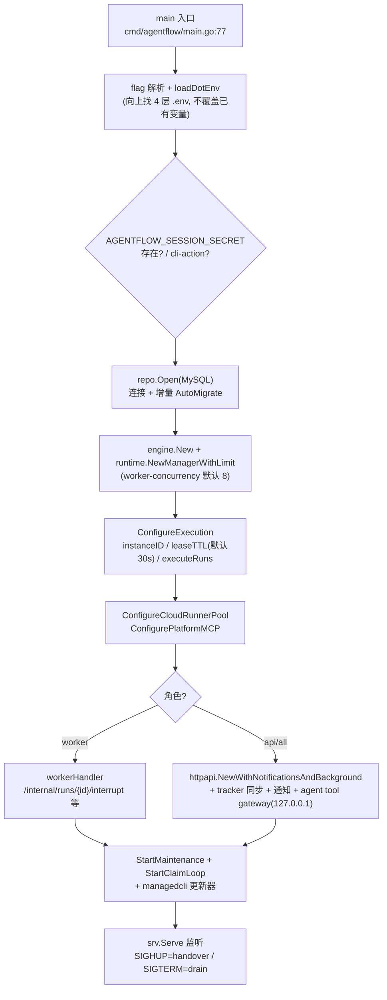
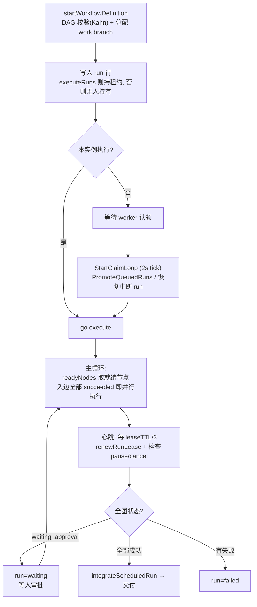
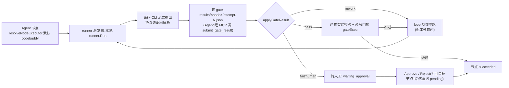
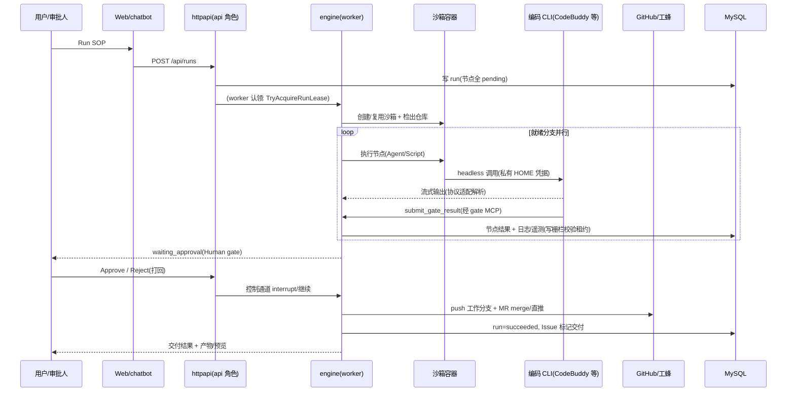
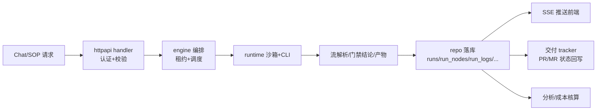
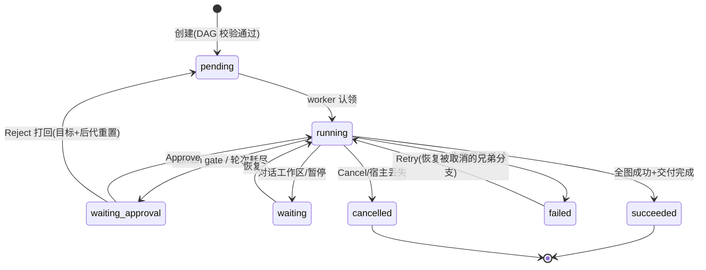
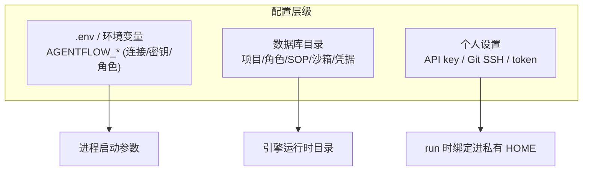
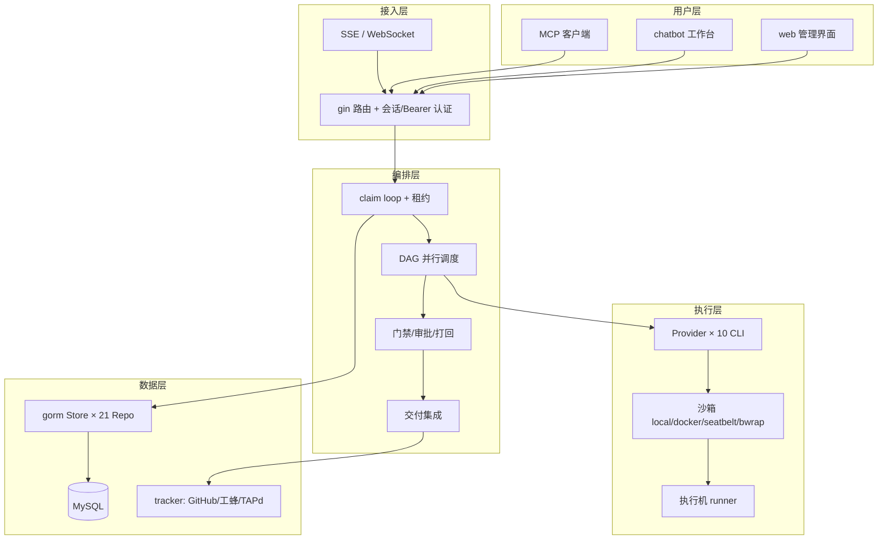

# LoopForge - 运行机制详解

> 生成时间: 2026-11-15
> 本文聚焦平台侧（`cmd/agentflow`）的运行机制；安装与配置见《使用指南》，模块划分见《架构分析》。

## 一、项目运行方式

LoopForge 是一个长驻服务进程，不是一次性 CLI。一个进程按 `-role`（或 `AGENTFLOW_ROLE`）扮演三种角色之一：`api`（HTTP 网关）、`worker`（执行）、`all`（默认，两者兼有）。多实例部署时各实例共享 MySQL，靠 run 租约协调。

### 1. 安装与执行

```bash
# 生产安装（拉取 GHCR 发布镜像，起 MySQL + platform 两个容器）
git clone https://github.com/Tencent/LoopForge.git && cd LoopForge
./start.sh                      # 等价 bash scripts/install.sh

# 源码开发（本机构建，Go 1.26.11+）
bash scripts/dev.sh             # 起 MySQL、装 admin、跑 migrations/seed、8090 端口起服务

# 手动运行二进制（需要 MySQL 与 AGENTFLOW_SESSION_SECRET）
go run ./cmd/agentflow -role all -addr :8090 -mysql-dsn "user:pass@tcp(127.0.0.1:3306)/loopforge"
```

### 2. 执行流程（进程启动）



**位置**: `cmd/agentflow/main.go:77-341`。

关键细节：
- **优雅停机**：SIGINT/SIGTERM 触发「停止认领 → 排空本地 run（默认上限 120 分钟，`AGENTFLOW_DRAIN_TIMEOUT`）→ 排空进程内会话任务 → HTTP Shutdown → 关库」；非 worker 角色收到 SIGHUP 会启动继承监听器的新进程（handover），旧进程等待其就绪后交接（`main.go:254-322`）。
- **agent tool gateway**：api 角色在 `127.0.0.1:0` 起一个仅回环的 HTTP 服务（`main.go:203-243`），供沙箱内 Agent 以平台身份回呼工具网关（写操作要过审批检查）。

## 二、核心运行机制

### 2.1 Run 生命周期：租约认领与分布式调度

**位置**: `internal/engine/run_start.go:67`（创建）、`run_state.go:130`（claim loop）、`run_recovery.go:107`（恢复）、`node_execute.go:16-185`（调度主循环）。

一条 run 的状态由数据库行（`runs` 表的 `OwnerInstanceID`/`Generation`/`LeaseUntil` 列，`models.go:289`）驱动，任何实例都能安全接管：



**机制作用**:
- **租约即所有权**：`acquireLease`（`run_recovery.go:66`）经 `repo.TryAcquireRunLease` 做 CAS（Generation+1）；心跳续租失败即失去 run；他实例持有活租约时本实例拒绝写 run（写栅栏 `run_state.go:34-45`）与提交节点结果（`node_outcome.go:37`）——多 worker 不会双写。
- **崩溃恢复**：进程死亡后租约过期，下一个 claim 循环 `ResumeInterruptedRuns` 接管：重置在途节点（Agent 节点保留 `ResumeSessionID` 续会话）、工作区绑定保护（宿主下线且代码已丢则按孤儿结算，`run_recovery.go:26-56`）。
- **分支并行**：`readyNodes`（`workflow_graph.go:11`）按入边拓扑并行拉起节点 goroutine；并发安全靠 `keyedLocks`（`parallel_exec.go:26`）的节点级/Agent 调用级/池绑定级锁。
- **并发上限**：`runtime.Manager` 用 `slots` 信号量限制同时活跃的沙箱数（`--worker-concurrency`，默认 8）。

### 2.2 节点执行与门禁自修正循环

**位置**: `internal/engine/node_execute.go:316`（executeNode）、`gate_submit.go`（门禁结果）、`node_outcome.go:13-86`（审批与失败处理）。

五类节点各有执行器；Agent 节点是最复杂的一环，形成「执行 → 门禁 → 反馈重跑」闭环：



- **门禁 MCP**：沙箱里跑着 `agentflow-gate-mcp`（stdio JSON-RPC），Agent 调 `submit_gate_result` 写 `AGENTFLOW_GATE_RESULT_PATH`，引擎轮询读回（`internal/gatemcp/server.go:37-58`，`engine/gate_submit.go:44-86`）——把「AI 自评」变成结构化、可审计的结论。
- **Human gate**：`waitApproval` 把 run 置为 `waiting_approval`；`Approve`（`run_ops.go:140`）写 decision.md 产物并继续；`Reject`（`run_ops.go:271`）把目标节点及其后代全部重置 pending、取消在途子 run。
- **失败策略**：`nodeFailedAt`（`node_outcome.go:50`）按配置自动重试 / 返工预算耗尽转人工 / 自动 Reject；轮次耗尽（`ErrMaxTurns`）转人工审批。
- **Sub-SOP**：`executeSOPNode`（`sop_node.go:18`）防环（嵌套上限 6 层），子 run 继承 `WorkspaceRunID` 共享父 checkout，完成后按契约导入产物。
- **Script 节点**：确定性 shell 步骤，沙箱内 `sh -lc`（`node_execute.go:616-628`）或派发到执行机。

### 2.3 沙箱与执行器协议（internal/runtime）

**位置**: `internal/runtime/provider.go:50`、`protocol.go:28`、`sandbox_manager.go:14`、`command_binding.go:32`。

- **统一 Provider 接口**：`Kind/Materialize/Prepare/Protocol/SandboxRequirements/...`。注册表里有 claude-code/codebuddy/codex/mock 四个原生 Provider，另有一个 `agentCLIProvider` 统一抽象其余 7 种 CLI（opencode/cursor/agy/kimi/pi/dsh/zcode），逐家拼 headless argv（如 opencode `run --format json`、cursor `-p --output-format stream-json`、dsh `--profile headless --json`），`provider_agentcli.go:104-228`。
- **流式解析四类协议**（`protocol.go:19-26`）：anthropic stream-json（Claude Code 与 CodeBuddy 共用）、codex JSONL、generic JSON、以及把 7 种 agent CLI 原生流改写成 Claude stream-json 的 `protocolTranslated`（`agent_cli_stream.go:162`）——观测层（ObservabilitySpec）对上只暴露 4 种适配器标识。
- **凭据隔离**：`CommandSpec` 只允许声明凭据绑定，不许任意 env（`runtime.go:76`）；绑定前先清空宿主全部凭据类环境变量，再在 workspace 下建 `.agentflow/private-home/<provider>` 私有 HOME 写入用户自己的 key/Base URL（`command_binding.go:43-73`、`agent_cli.go:365`）——同一台执行机上，每个 run 用的是责任人自己的凭据。
- **沙箱驱动**：local（docker 兄弟容器或宿主直接跑）、docker（`docker exec` 进 `/workspace`，cwd 挂载失效自动 `Recreate` 容器，`sandbox_docker.go:202-269`）、seatbelt（macOS）、bwrap（Linux 沙箱）。孤儿容器由 `ReclaimDockerSandboxes` 直接对账 Docker 实况回收（`sandbox_manager.go:188`）。
- **工作区检查点**：`CreateWorkspaceCheckpointTo` 打 tar+gzip（内联 12MB / 归档 512MB / 解压 2GB 上界，排除 node_modules 等，`workspace_checkpoint.go:28-68`）；重跑前 `restoreCheckpointBeforeExecution`（`run_ops.go:499`）恢复；对话工作区空闲时后台保存。
- **两种工作区**：**SOP run 工作区**随 run 存活、终态清理；**对话工作区**（RunKindWorkspace）有使用租约 token、空闲即 checkpoint+清理（`conversation_workspace.go:44-384`），供 Main Bot 聊天和多轮复用。

### 2.4 交付（Deliver）：从工作分支到 MR

**位置**: `internal/engine/integrate.go:53-287`。

全图成功后 `integrateScheduledRun` 对每个仓库拿跨实例集成锁 → merge 最新 integration 分支 → push 工作分支 → `mergeWorkBranchIntoIntegrate`：优先工蜂 MR merge（默认分支绝不自动合入），否则按 `mode=direct` 直推；冲突自动生成 `integrationRepairNode` 返工节点（上限 3 轮）。`finishAt`（`node_outcome.go:320`）标记 Issue 交付、清理工作区、终稿化预览。

### 2.5 执行机（Runner）与云池

**位置**: `internal/runner/daemon.go:25`、`client.go:124-252`、`internal/engine/runner_dispatch.go`、`cloud_pool.go:22`。

执行机只发出站连接：HTTPS 任务面（长轮询 `WaitForTask` + `Claim` + 租约续期 + 事件上报）+ WSS 控制面（`GET /runners/connect`，30s ping）。注册凭据三选一：一次性绑定码（个人 runner）、共享 bootstrap token（池 runner）、用户 token。云池（`AGENTFLOW_CLOUD_RUNNER_LABEL/PROJECTS`）让指定项目的 run 等待/迁移到池机器执行；`AGENTFLOW_LOCAL_EXECUTION=false` 可禁止本机执行池项目节点。

### 2.6 人工干预面：暂停、重跑、取消

**位置**: `internal/engine/run_ops.go`。

| 操作 | 入口 | 行为 |
|------|------|------|
| Approve / Pass | `run_ops.go:140/186` | 门禁通过、继续调度 |
| Reject（打回） | `run_ops.go:271` | 目标节点+后代重置 pending，取消在途子 run |
| Retry（从节点重跑） | `run_ops.go:359` | 后代重置；要求上游已成功可回放；工作区已清理则先恢复检查点；**取消后的并行兄弟分支一并复活**（`run_ops.go:560-572`） |
| Pause / ResumePaused | `run_ops.go:109/637` | 心跳检测到暂停即挂起 |
| Cancel | `run_ops.go:47` | 取消调度器、结算为 cancelled |

## 三、完整工作流程

### 场景 1: 在 Chat 里让 Main Bot 修 bug 并开 PR

1. 用户在 chatbot 输入需求，`@` 引用角色/技能/需求/仓库，选择执行器与模型。
2. 平台按需打开**对话工作区**（Docker 沙箱 + 检出仓库），Main Bot 以所选 CLI 运行，项目角色作为子代理被调用。
3. 消息在回复期间可排队（queue）或插队（steer）；写操作经平台工具网关与审批检查。
4. 完成后经 Git SSH/token 推分支、开 PR/MR；需求（requirement）与这次变更关联，计入交付与成本。

### 场景 2: 运行一个 SOP

1. 从内置模板复制 SOP 到项目，在画布上编辑节点（Agent/Script/Human-gate/Sub-SOP/Preview）与失败回边。
2. 「Run SOP」创建 run：DAG 校验 → 分配 work branch → 引擎认领 → 就绪分支并行执行。
3. 每个 Agent 节点在沙箱内以角色配置（提示词/执行器/模型/规则/Skills/MCP）运行，结束时提交结构化门禁结论；Script 节点跑确定性检查。
4. 到 Human gate 时 run 进入 waiting_approval，出现在「Needs review」收件箱；审批人可批准、加上下文重跑该步，或打回上游任一步。
5. 全部通过 → 交付：push 工作分支 → MR merge 或 direct 合入；产物、日志、工具轨迹、每节点快照留档；run eval 可做 AI 复盘并给出 SOP 改进建议。

### 完整工作流序列图（SOP run）



## 四、数据流与状态管理

### 4.1 数据流转



### 4.2 关键数据结构

| 结构 | 用途 | 定义位置 |
|------|------|----------|
| `Engine` | 编排核心：repo/沙箱/runner/运行表/锁表/云池/控制通道 | `internal/engine/engine.go:19-93` |
| `runs` 行（Owner/Generation/LeaseUntil） | 分布式租约所有权 | `internal/repo/models.go:289` |
| `Provider` 接口 | 执行器抽象（十种 CLI） | `internal/runtime/provider.go:50` |
| `CommandSpec` | 封闭的执行声明（只许凭据绑定） | `internal/runtime/runtime.go:76` |
| `RunCredentials` | 内存中的用户凭据（绝不落库） | `internal/runtime/runtime.go:42` |
| `runtime.Manager` | 沙箱池与并发槽位 | `internal/runtime/sandbox_manager.go:14` |
| `assistant_sessions` 行 | 助手会话（无独立 conversations 表） | `internal/repo/models.go:547` |

### 4.3 Run 状态管理



## 五、扩展机制

### 5.1 插件/扩展系统

- **执行器 Provider**：实现 `Provider` 接口并注册即可接入新的编码 CLI（`provider.go:124-131` 的注册表模式）。
- **MCP**：平台自身经 `/mcp` 暴露全部操作契约（`mcpserver.LocalInvoker` 回放 gin handler）；沙箱内 Agent 可用项目配置的 MCP 工具；知识库经 MCP 代理访问。
- **SOP 模板**：generic_templates 表 + 定义版本（definition_revisions），内置后端/前端/修 bug/产品四套 SOP，复制到项目即可改。
- **跟踪器适配**：`internal/tracker` 以 MCP 网关（工蜂/TAPd）与 REST（GitHub）两类适配器对接 Issue/PR。

### 5.2 钩子点

| 钩子 | 触发时机 | 用途 | 注册位置 |
|------|----------|------|----------|
| `CloudRunnerPool` | 项目 run 启动 | 强制走池执行机 | `cmd/agentflow/main.go:164` |
| `MergeIntoBranch`/`FindBranchMR` | 交付集成 | 工蜂 MR 合并回调注入 | `internal/engine/engine.go` |
| `preview.Host` | 预览归档/上传 | 引擎与预览服务解耦 | `internal/engine/engine.go:144` |
| schedule 的 Dispatcher/BaselineGuard/AssistantPrep | 定时触发 | 需求派发与助手任务准备 | `internal/schedule/service.go` |
| run eval 三段（Facts→Prompt→Apply） | run 结束后 | AI 复盘并改 SOP | `internal/runeval/facts.go:22` 等 |

### 5.3 配置管理

配置全部来自环境变量/`.env`（`main.go` 的 `loadDotEnv` 向上查找 4 层目录，已存在的环境变量优先）+ 数据库内的目录数据（角色/规则/Skill/沙箱/SOP）。`internal/config/endpoints.go` 一次性解析进程级端点与角色。主要变量清单见《使用指南》第 2 节。



## 六、运行时架构总结



## 总结

LoopForge 的运行机制围绕以下核心概念：

1. **数据库即协调者**：run 的所有权、节点结果、工作区绑定全靠 MySQL 行级租约与写栅栏，api/worker 多实例无主协调。
2. **DAG 分支并行**：入边就绪即并行执行，取消/打回只重置受影响子图，重跑能恢复被误伤的兄弟分支。
3. **结构化门禁闭环**：Agent 通过 MCP 提交 pass/rework/fail/human 结论，引擎按预算自动返工、耗尽转人工，避免「AI 自说自话」。
4. **执行器即适配器**：十种编码 CLI 归一到 Provider 接口与四种流协议，凭据按用户/Agent 隔离在私有 HOME。
5. **沙箱即边界**：默认 Docker 兄弟容器隔离每个 run/对话，检查点让工作区可恢复、可迁移到执行机。
6. **优雅的生命周期管理**：SIGHUP handover、租约接管、drain 排空，长任务可以跨部署存活。

这种设计使 LoopForge 既**保持了单二进制部署的简单性**（compose 一键起），又**具备多 worker/执行机横向扩展与崩溃恢复能力**，非常适合团队把编码代理 CLI 纳入可审计、可审批、可复制的软件交付流水线。
